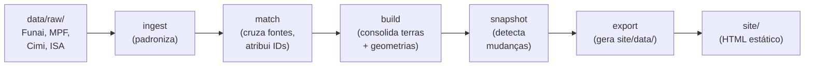

# 🗺️ Demarcação em Dados

> **Pipeline de dados + site estático** que reúne informações de **Funai, MPF, Cimi e ISA** em uma base única sobre o procedimento de demarcação de terras indígenas no Brasil.

Cada terra recebe um **ID interno estável** (`TI0001`…), mostra **polígonos** onde existem e **pontos aproximados** onde a terra ainda não tem geometria publicada, e **guarda o histórico** de cada mudança de fase.

<p align="center">
  <strong><a href="#-o-site">Site estático</a></strong> · <strong><a href="#-pipeline-de-dados">Pipeline</a></strong> · <strong><a href="#-dados-abertos">Dados abertos</a></strong> · <strong><a href="#-atualizando-rotina">Atualização</a></strong>
</p>

---

## ✨ Funcionalidades

- **Mapa interativo** com MapLibre GL JS (funciona offline, exceto mapa-base OSM opcional)
- **Busca e filtros** por fase do processo, UF, limite oficial e divergência entre fontes
- **Painel de detalhes** com etapa jurídica, processos judiciais, linha do tempo e fontes
- **Link permanente** por terra (`#TI0123`) com botões de copiar link e citação
- **Histórico automático** de mudanças detectadas a cada atualização
- **Dados abertos** em CSV e GeoJSON para download direto no site
- **Proteção de terras sensíveis** (povos isolados): localização degradada para UF
- **Cruzamento inteligente** entre fontes com revisão humana assistida

## 📐 Arquitetura

```
data/raw/<fonte>/  →  ingest  →  match  →  build  →  snapshot  →  export  →  site/data/
 (você baixa)        interim     crosswalk   processed    history
```



| Módulo | Arquivo | Função |
|---|---|---|
| **ingest** | `demarcacao/ingest.py` | Lê shapefiles, PDFs, CSVs/XLSX e padroniza em `data/interim/<fonte>.csv` |
| **match** | `demarcacao/match.py` | Cruza fontes por nome (RapidFuzz), atribui `terra_id` estável, gera `revisar.csv` |
| **build** | `demarcacao/build.py` | Consolida em `terras.csv`, resolve geometria (polígono > município > UF) |
| **history** | `demarcacao/history.py` | Compara snapshots, registra eventos e observações |
| **export** | `demarcacao/export.py` | Gera GeoJSON, índice, fichas por terra e downloads para o site |
| **validate** | `demarcacao/validate.py` | Checagens de integridade (IDs, fases, vínculos) |
| **normalize** | `demarcacao/normalize.py` | Normalização de nomes, UFs, números brasileiros e fases |
| **refs** | `demarcacao/refs.py` | Baixa municípios/UFs do IBGE para geolocalizar terras sem polígono |

## 📋 Pré-requisitos

- **Python 3.11+**
- **Git** (para versionamento)
- **Node.js 18+** (opcional, para testes do site)
- **Make** (opcional, para atalhos — no Windows, use os comandos Python diretamente)

## 🚀 Instalação

```bash
# Clone o repositório
git clone https://github.com/SEU_USUARIO/demarcacao-hub.git
cd demarcacao-hub

# Crie e ative o ambiente virtual
python -m venv .venv
# Linux/macOS:
source .venv/bin/activate
# Windows:
.venv\Scripts\activate

# Instale as dependências
pip install -r requirements.txt

# Confirme que tudo funciona (8 testes)
python -m pytest -q
```

### Dependências principais

| Pacote | Uso |
|---|---|
| `pandas` ≥ 2.0 | Manipulação de dados tabulares |
| `geopandas` ≥ 0.14 | Dados geoespaciais |
| `shapely` ≥ 2.0 | Operações geométricas |
| `pyogrio` ≥ 0.7 | Leitura de shapefiles/GPKG |
| `pdfplumber` ≥ 0.10 | Extração de tabelas de PDF |
| `rapidfuzz` ≥ 3.0 | Comparação fuzzy de nomes |
| `pyyaml` ≥ 6.0 | Leitura de configurações YAML |
| `requests` ≥ 2.31 | Download de dados do IBGE |
| `openpyxl` ≥ 3.1 | Leitura de arquivos XLSX |

## 📊 Pipeline de dados

### Primeira rodada completa

```bash
# 1. Baixa referências do IBGE (municípios, UFs, contornos)
python -m demarcacao fetch-ref

# 2. Coloque os arquivos brutos nas pastas certas:
#    data/raw/funai/  → shapefile (.zip/.shp/.gpkg) das Terras Indígenas
#    data/raw/mpf/    → "Tabela Terras Indígenas 2025.pdf" (ou CSV/XLSX)
#    data/raw/cimi/   → CSV do levantamento do Cimi (opcional)
#    data/raw/isa/    → dados do ISA, se permitido (opcional)

# 3. Inspecione as colunas reais dos arquivos
python -m demarcacao inspect data/raw/funai/ARQUIVO.zip
python -m demarcacao inspect data/raw/mpf/ARQUIVO.pdf
# Ajuste os nomes de colunas em config/sources.yml se necessário

# 4. Pipeline completo
python -m demarcacao update

# 5. Abra o site local
python -m http.server 8000 -d site
# Acesse http://localhost:8000
```

### Comandos disponíveis

| Comando | Descrição |
|---|---|
| `python -m demarcacao inspect <arquivo>` | Mostra colunas e amostra de um arquivo bruto |
| `python -m demarcacao fetch-ref` | Baixa municípios/UFs do IBGE |
| `python -m demarcacao fetch [--fonte X]` | Baixa fontes com URL configurada |
| `python -m demarcacao ingest [--fonte X]` | raw → interim |
| `python -m demarcacao match [--data AAAA-MM-DD]` | Cruza fontes e atribui `terra_id` |
| `python -m demarcacao build` | Gera `terras.csv` e geometrias |
| `python -m demarcacao snapshot [--data AAAA-MM-DD]` | Compara com snapshot anterior |
| `python -m demarcacao export` | Gera `site/data/` |
| `python -m demarcacao validate` | Checagens de integridade |
| `python -m demarcacao update [--data AAAA-MM-DD]` | Pipeline completo (todos os anteriores) |
| `python -m demarcacao status` | Mostra o que há em cada etapa |

Ou, se tiver `make`:

```bash
make setup    # instala dependências
make ref      # baixa referências do IBGE
make update   # pipeline completo
make test     # roda os testes
make site     # abre o site em http://localhost:8000
make status   # mostra o estado atual
```

## 🌐 O site

O site em `site/` é **100% estático**: HTML, CSS e JavaScript puros, com **MapLibre GL JS** incluído em `site/vendor/` (funciona sem internet, exceto o botão opcional de mapa-base OpenStreetMap).

### Telas

| Tela | Conteúdo |
|---|---|
| **Mapa** | Busca, filtros por fase/UF/limite oficial/divergência, painel com etapa, jurídico, linha do tempo e fontes |
| **Dados** | Downloads em CSV e GeoJSON |
| **Metodologia** | Fases do processo, localização, fontes divergentes, histórico, limitações |
| **Sobre** | Princípios, versão e responsáveis |

### Personalização

Título e subtítulo do site: `config/settings.yml` → seção `export`.

### Testes do site

```bash
# Pipeline (Python)
python -m pytest -q

# Lógica do site (JavaScript, precisa de Node 18+)
node --test site/tests/logic.test.js
```

## 🔄 Atualizando (rotina)

1. **Baixe** o arquivo novo da fonte para `data/raw/<fonte>/` (o mais recente por data de modificação vale).
2. `python -m demarcacao update` — o pipeline compara com o snapshot anterior, registra eventos e regenera o site.
3. **Confira** `data/crosswalk/revisar.csv` (pares prováveis), `data/processed/relatorios/` e os avisos do `validate`.
4. **Versione**:
   ```bash
   git add data/crosswalk data/processed data/history
   git commit -m "Atualização de dados AAAA-MM-DD"
   git push
   ```

Para uma data específica: `python -m demarcacao update --data 2026-12-01`.

## 🔍 Revisando o cruzamento entre fontes

Depois de cada `update`, abra `data/crosswalk/revisar.csv` no Excel (usa `;` como separador, abre direto).

Cada linha é um registro de fonte (geralmente do MPF) que pode ser a mesma terra de uma candidata (geralmente da Funai). Compare **município e área** e preencha a coluna `decisao`:

| Valor | Efeito |
|---|---|
| `sim` | A linha passa para a terra candidata (status `confirmado`, permanente) |
| `nao` | O par vai para `pares_distintos.csv` e nunca mais é sugerido |

Salve como CSV e rode `python -m demarcacao update` outra vez. Linhas sem decisão continuam pendentes.

> **⚠️ Importante:** Não apague `data/crosswalk/`: os IDs (`TI0001`…) precisam ser estáveis entre versões.

## 📁 Estrutura de diretórios

```
demarcacao-hub/
├── config/                    # Configurações YAML
│   ├── fases.yml              # Mapeamento de rótulos → fases canônicas
│   ├── settings.yml           # Prioridades, limiares, export
│   └── sources.yml            # Definição das fontes e colunas
├── data/
│   ├── raw/<fonte>/           # Arquivos brutos (NÃO versionados)
│   ├── interim/               # Dados padronizados (NÃO versionados)
│   ├── crosswalk/             # IDs e vínculos entre fontes (VERSIONADOS)
│   ├── processed/             # terras.csv, geometrias, relatórios (VERSIONADOS)
│   ├── history/               # Snapshots, eventos, marcos (VERSIONADOS)
│   └── ref/                   # Referências IBGE
├── demarcacao/                # Módulo Python do pipeline
│   ├── cli.py                 # Interface de linha de comando
│   ├── ingest.py              # Leitura e padronização de fontes
│   ├── match.py               # Cruzamento entre fontes
│   ├── build.py               # Consolidação e geometrias
│   ├── history.py             # Histórico e snapshots
│   ├── export.py              # Geração dos dados do site
│   ├── validate.py            # Checagens de integridade
│   ├── normalize.py           # Normalização de texto
│   ├── refs.py                # Referências IBGE
│   ├── schema.py              # Vocabulário canônico (fases, colunas)
│   ├── config.py              # Leitura de configurações
│   └── paths.py               # Caminhos do projeto
├── docs/
│   ├── metodologia.md         # Detalhes metodológicos
│   └── dicionario_dados.md    # Dicionário de dados
├── site/
│   ├── index.html             # Página única do site
│   ├── assets/                # CSS e JS do site
│   ├── data/                  # Dados gerados (NÃO versionados)
│   ├── vendor/maplibre-gl/    # MapLibre GL JS (funciona offline)
│   └── tests/                 # Testes JavaScript
├── tests/                     # Testes Python (pytest)
├── Makefile                   # Atalhos
├── requirements.txt           # Dependências Python
├── CITATION.cff               # Metadados de citação
└── .gitignore
```

## 📦 O que é versionado

| Pasta | Versionar? | Conteúdo |
|---|---|---|
| `data/raw/` | ❌ (grande) | Arquivos baixados; sha256 e data ficam em `data/interim/ingest_meta.json` |
| `data/interim/` | ❌ | Dados padronizados intermediários |
| `data/crosswalk/` | ✅ | IDs e vínculos entre fontes (editável à mão) |
| `data/processed/` | ✅ | `terras.csv`, relatórios, geometrias |
| `data/history/` | ✅ | Snapshots, eventos, marcos curados |
| `site/data/` | ❌ | Regenerado por `export` |

> 💡 Guarde os arquivos brutos em outro lugar (Zenodo, Drive institucional, Git LFS) para reprodutibilidade.

## 🏗️ Fases do processo de demarcação

As fases seguem a ordem do procedimento administrativo (Decreto nº 1.775/1996):

| Fase | Descrição |
|---|---|
| `sem_providencia` | Sem providência / reivindicada |
| `em_estudo` | Em estudo (identificação) |
| `delimitada` | Delimitada (relatório aprovado) |
| `declarada` | Declarada (portaria declaratória) |
| `homologada` | Homologada (decreto presidencial) |
| `regularizada` | Regularizada (registrada em cartório) |

Categorias especiais (fora da sequência): `reserva_em_constituicao`, `restricao_de_uso`.

O mapeamento dos rótulos de cada fonte está em `config/fases.yml`.

## 📍 Pontos aproximados → polígonos

Terras sem polígono recebem ponto no município (ou UF). Quando a Funai publicar o polígono e o nome casar, a terra troca de ponto para polígono automaticamente e o evento `precisao_geom: municipio → poligono` entra no histórico.

## 🔒 Terras sensíveis (povos isolados)

Registros cujo nome/povo contenha palavras de `config/settings.yml → sensivel` aparecem no site apenas com localização por UF e sem município. **Valide essa política com a Funai antes de publicar.**

## 📅 Histórico: dois tipos de data

- **`data/history/eventos.csv`**: o que o pipeline **observou** mudar, e quando observou. Não é a data do ato.
- **`data/history/marcos_terra.csv`** e **`marcos_gerais.csv`**: **datas oficiais** (portarias, decretos, decisões), com fonte. Marcos gerais incluem linhas de partida marcadas `a_verificar` — confira todas antes de publicar.

## ⚠️ Limitações conhecidas

- Os nomes de colunas da Funai e a leitura do PDF do MPF **não foram testados contra os arquivos reais** (só dados sintéticos). Use `inspect` e ajuste `config/sources.yml`.
- `fetch-ref` usa a API de localidades/malhas do IBGE. Se a API mudar, coloque `municipios.csv` e `ufs.csv` manualmente em `data/ref/`.
- O mapa usa tiles de demonstração do MapLibre. Troque o `style` em `site/index.html` antes de publicar.
- Fases como `Encaminhada RI` e `Interditada` da Funai aparecem em `data/processed/relatorios/fases_nao_mapeadas.csv` para decisão manual.
- Terras sensíveis só são degradadas para UF quando **não têm polígono** publicado.
- Dados inferidos do texto (como `ato_data`) devem ser conferidos antes de citar.

## 🧪 Testes

```bash
# Testes do pipeline Python (8 testes)
python -m pytest -q

# Testes da lógica do site (JavaScript)
node --test site/tests/logic.test.js
```

Os testes Python usam **dados sintéticos** e cobrem:
- Pipeline completo (ingest → match → build → histórico → export)
- Vinculação automática e fusão de duplicatas
- Revisão humana (decisões `sim`/`nao`)
- Grafias equivalentes (Xukuru/Xucuru, Zo'é/Zoe)
- Empate entre candidatas → revisão
- Fases especiais e relatórios
- Dados jurídicos e datas de atos
- Proteção de terras sensíveis
- Geração dos arquivos do site

## 📖 Documentação

- [`docs/metodologia.md`](docs/metodologia.md) — Detalhes metodológicos (fontes, fases, reconciliação, ética)
- [`docs/dicionario_dados.md`](docs/dicionario_dados.md) — Dicionário de dados de todos os CSVs

## 📝 Como citar

```
[Nome da terra] (TI0XXX). Demarcação em Dados, versão X.X.X, dados observados em DD/MM/AAAA.
Fontes: Funai, MPF. Acesso em DD/MM/AAAA. URL.
```

Veja também o arquivo [`CITATION.cff`](CITATION.cff).

## 🤝 Contribuindo

1. Faça um fork do repositório
2. Crie uma branch para sua feature (`git checkout -b feature/minha-feature`)
3. Commit suas mudanças (`git commit -m 'Adiciona minha feature'`)
4. Push para a branch (`git push origin feature/minha-feature`)
5. Abra um Pull Request

### Para ampliar o site

Notícias podem ser adicionadas em `site/data/terras/<ID>.json` no campo `noticias` (lista de `{titulo, fonte, data, url}`). O painel já sabe exibi-las.

## 📄 Licença

**A definir** pelos responsáveis do projeto. Sugestão: código MIT, dados CC BY 4.0 (respeitando as licenças das fontes originais).

---

<p align="center">
  Feito com ❤️ para a transparência sobre demarcação de terras indígenas no Brasil.
</p>
